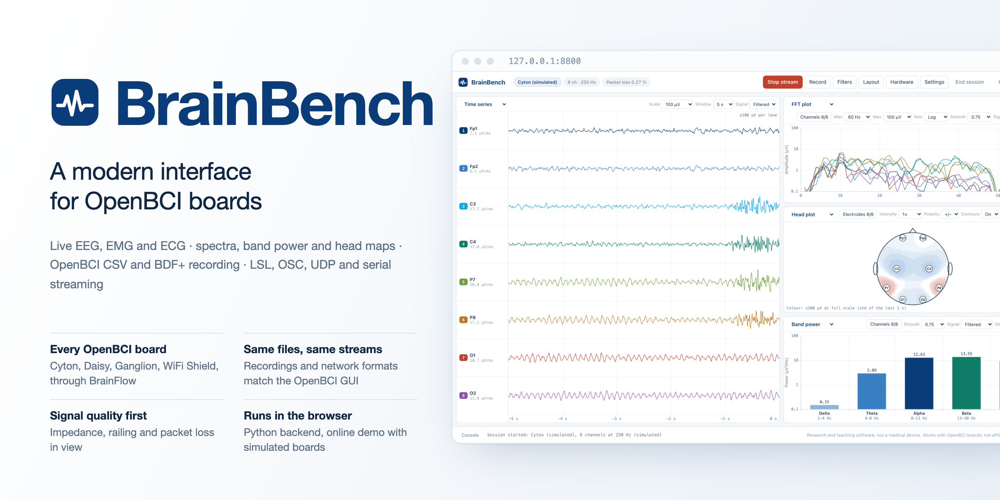
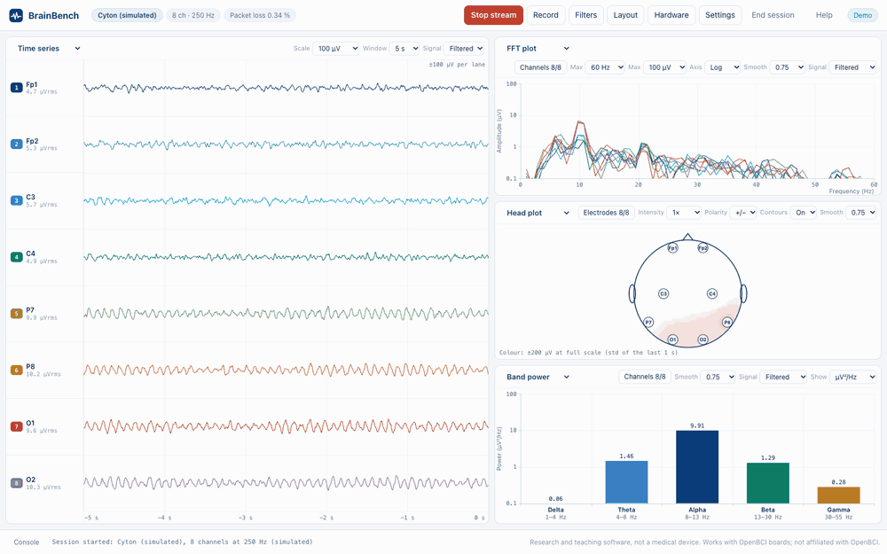
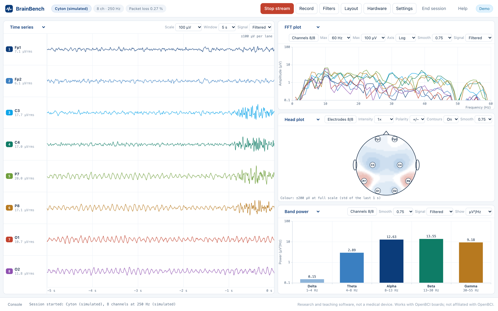
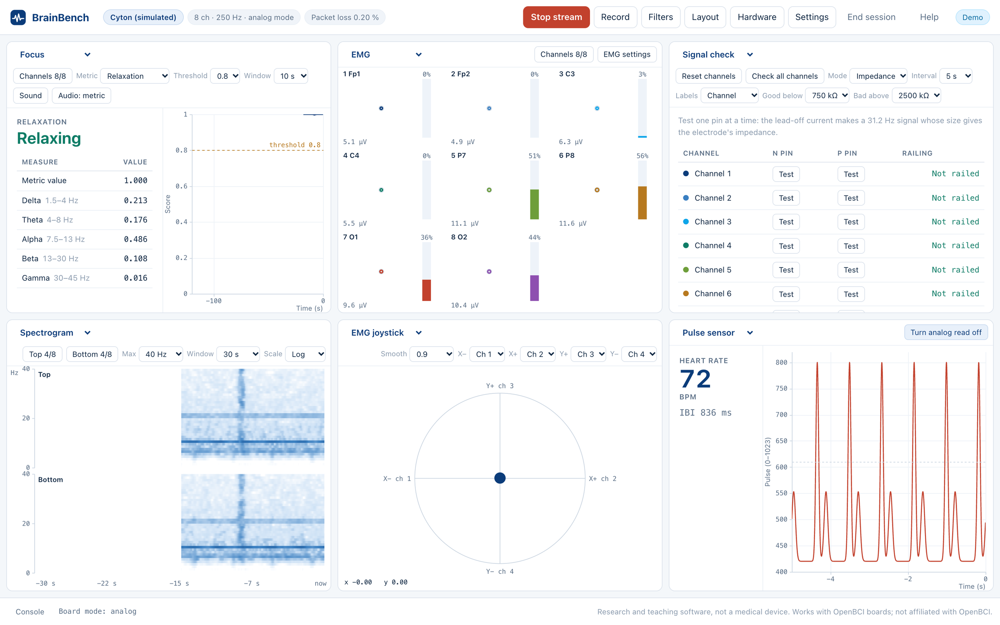
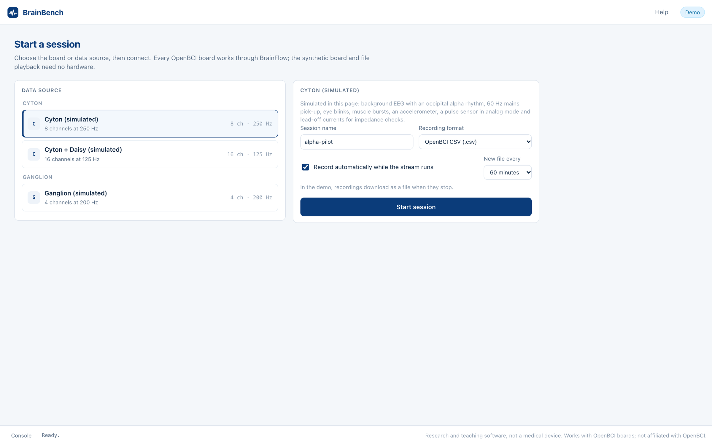
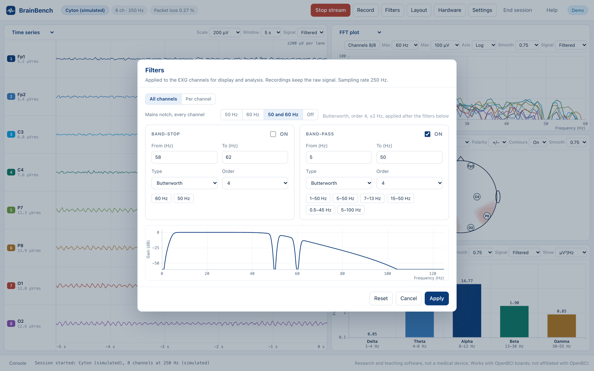

<p align="center">
  
</p>

<p align="center">
  <a href="https://abrilcode.github.io/brainbench/demo/"></a>
  <a href="https://github.com/abrilcode/brainbench/actions/workflows/ci.yml"></a>
  
  
  
  <a href="LICENSE"></a>
  
</p>

**BrainBench is a modern interface for OpenBCI boards: live EEG, EMG and ECG, analysis, recording and streaming to other programs.** It covers what the OpenBCI GUI does (every board, every widget, the same file and network formats) in a clean, fast browser interface backed by Python and [BrainFlow](https://brainflow.org).

**[Open the live demo →](https://abrilcode.github.io/brainbench/demo/)** It runs entirely in the browser with a simulated Cyton, Cyton + Daisy or Ganglion. No installation needed.

<p align="center"></p>

## Highlights

- **Every OpenBCI board.**
  - Supported boards: Cyton, Cyton + Daisy, Ganglion (BLED112 dongle or the computer's own Bluetooth), and the WiFi Shield for both.
  - No-hardware sources: BrainFlow's synthetic board, file playback, and BrainFlow multicast streams from other programs.
- **All seventeen OpenBCI GUI widgets.**
  - Signals and spectra: Time series, FFT, Band power, Head plot, Spectrogram.
  - Board inputs: Accelerometer, Analog read, Digital read, Pulse sensor.
  - EMG and BCI: EMG, EMG joystick, Focus (with audio feedback).
  - Session tools: Signal check (impedance and railing), Marker, Packet loss, Networking, Playback.
- **Drop-in compatible.**
  - Recordings are written in the OpenBCI GUI's CSV format (same header, column names and separator), so files move freely between the two programs. BDF+ and BrainFlow CSV are also available.
  - The Networking widget sends the same UDP, LSL, OSC and serial payloads, so existing MATLAB, Python, Unity or OpenViBE scripts keep working.
- **Same signal processing, checked against SciPy.**
  - Defaults match the GUI: band-pass 5–50 Hz, notch at 50 and 60 Hz, a Hamming-window FFT with the GUI's smoothing, and the GUI's band edges.
  - The filter designs are Butterworth, Chebyshev and Bessel at orders 1–8. Their responses match SciPy to within 10⁻⁶, and the streaming output to within 10⁻⁸.
- **Signal quality in view.**
  - Every channel shows its RMS amplitude and its railing state.
  - The Signal check widget measures impedance with the ADS1299 lead-off current, then restores each channel's settings afterwards.
  - Packet loss is counted from the sample counter, with counter wrap-around handled correctly.
- **Built for experiments.**
  - Markers: keyboard shortcuts, buttons, and a UDP port for other programs, written into the recording and shown on the traces.
  - Recording: automatic recording while streaming, one folder per session, and a new file at a chosen length.
  - Playback: a seek bar.
  - Layouts: ten panel layouts, with settings saved to and loaded from files.
- **Tested.**
  - 29 Python tests: sessions, file round-trips, BDF+ decoding, network payloads, the server API and the focus model.
  - 12 JavaScript tests: DSP against SciPy fixtures, EMG, pulse detection, CSV columns.
  - A headless-browser check that opens every widget and dialog on every board.

## Quick start

```bash
pipx install git+https://github.com/abrilcode/brainbench    # or: pip install git+https://github.com/abrilcode/brainbench
brainbench                                                  # opens http://127.0.0.1:8800
```

Choose a data source on the start screen and press **Start session**. **Synthetic** and **File playback** need no hardware.

From a clone, for development:

```bash
git clone https://github.com/abrilcode/brainbench && cd brainbench
python -m venv .venv && . .venv/bin/activate
pip install -e ".[dev]"
brainbench --port 8800
```

`brainbench --help` lists the options: `--host`, `--port`, `--no-browser` and `--data-dir`, which can also be set as `$BRAINBENCH_HOME`. Recordings and settings files go to `Documents/BrainBench` by default. [docs/getting-started.md](docs/getting-started.md) walks through a first recording with a real board.

## The interface

<p align="center"></p>

The layout follows the OpenBCI GUI:
- **Toolbar:** a toolbar across the top starts and stops the stream (**Space**), records, and opens the filters, layout, hardware and settings.
- **Panels:** the workspace below is a grid of panels. Each panel shows any widget, chosen from the menu in its title.
- **Panel options:** a panel's options sit in its header and are kept between sessions.

<p align="center"></p>

<table>
<tr>
<td width="50%"></td>
<td width="50%"></td>
</tr>
<tr>
<td><b>Start screen.</b> Sources are grouped by board. Connection options include the serial port, IP address, SD-card mode, dongle radio tools and the BrainFlow streamer.</td>
<td><b>Filters.</b> The dialog sets the mains notch, a band-stop and a band-pass, for all channels or per channel, and draws the combined frequency response live.</td>
</tr>
</table>

### Keyboard

| Key | Action |
|---|---|
| Space | Start or stop the stream |
| z x c v · Z X C V | Insert markers 1–4 · 5–8 |
| f · l | Filters · layout |
| Expert mode: 1–8 · ! @ # $ % ^ & * | Channels 1–8 off · on |
| Expert mode: q–i · Q–I | Channels 9–16 off · on |
| Expert mode: n · N | Save · load the User settings |
| Expert mode: ? · [ ] | Print the Cyton's registers · the board's square-wave test signal |

Expert mode is switched on in **Settings** and uses the OpenBCI GUI's keys. The marker keys work without it.

## How it works

```
 OpenBCI board ── BrainFlow ──► Python server (FastAPI) ──WebSocket──► browser interface
                                 │  acquisition thread                 │  filters, FFT, band power,
                                 │  recording (CSV, BDF+)              │  head plot, EMG, focus,
                                 │  network outputs (LSL, OSC, UDP,    │  pulse, all charts
                                 │    serial), markers on UDP 12350    │
                                 └─ board commands, impedance, radio ◄─┘  settings, layouts
```

- **The server owns everything that must not depend on a browser tab:**
  - the board connection;
  - an acquisition thread that reads BrainFlow about 30 times a second;
  - recording to disk;
  - the network outputs;
  - the Cyton's channel commands.

  Each chunk goes to the browser as one binary WebSocket frame: two `uint32` values (rows, samples) followed by `float32` data.
- **The browser does the display processing.** The filters run as second-order sections, designed with the same analog prototypes, transforms and pre-warping as SciPy. FFT, Welch, band power, the EMG envelope and pulse detection are small dependency-free modules in [`web/static/js`](src/brainbench/web/static/js).
- **The online demo is the same interface** with the server replaced by a simulated board in the page. The simulator models pink-noise EEG, an alpha rhythm, mains hum, blinks, EMG bursts, lead-off signals, an accelerometer, a pulse sensor and occasional packet loss. Recordings made in the demo download as OpenBCI CSV files.

The [feature list](docs/parity.md) maps every OpenBCI GUI feature to its place in BrainBench and notes the few differences.

## Documentation

| | |
|---|---|
| [Getting started](docs/getting-started.md) | Install, connect a board, first recording, playback |
| [Boards and electrodes](docs/hardware.md) | Cyton, Daisy, Ganglion, WiFi Shield; channel settings, impedance, SD card, radio, troubleshooting |
| [Streaming to other programs](docs/networking.md) | UDP, LSL, OSC and serial payloads for every data type, markers from other programs |
| [File formats](docs/file-formats.md) | OpenBCI CSV, BDF+, BrainFlow CSV; what playback accepts |
| [Feature list](docs/parity.md) | Every OpenBCI GUI feature and where it lives in BrainBench |

## Tests

```bash
pytest -q                                              # 29 Python tests
node --test web-tests/*.test.mjs                       # 12 JavaScript tests (Node 22+)
brainbench --no-browser --port 8800 &
node tools/check.mjs "http://127.0.0.1:8800/?demo"     # every widget and dialog, simulated boards
node tools/check.mjs http://127.0.0.1:8800/ --local    # synthetic board, recording, playback
```

`python web-tests/make_fixtures.py` regenerates the SciPy and BrainFlow fixtures. CI runs all of the above on Python 3.10–3.13.

## Project layout

```
src/brainbench/
  boards.py, session.py      data sources, board layouts, the acquisition loop, packet loss
  hardware.py, radio.py      Cyton and Ganglion commands, impedance, the dongle's radio
  recording.py, formats.py   OpenBCI CSV, BDF+, BrainFlow CSV writers and readers
  playback.py, network.py    playback preparation; LSL, OSC, UDP and serial outputs
  focus.py, settings.py      BrainFlow's focus models; settings files
  web/server.py              FastAPI app: REST API and the WebSocket stream
  web/static/                the interface (no build step): js/widgets, js/dialogs, dsp.js, demo.js
tests/, web-tests/, tools/   Python tests, JavaScript tests, browser check
```

## Licence and credits

MIT licence. Designed and built by **Abril Herrlein**.

BrainBench is inspired by the [OpenBCI GUI](https://github.com/OpenBCI/OpenBCI_GUI) (MIT) and talks to the boards through [BrainFlow](https://github.com/brainflow-dev/brainflow) (MIT). It is an independent project, not affiliated with or endorsed by OpenBCI. OpenBCI, Cyton and Ganglion are trademarks of OpenBCI, Inc.

BrainBench is research and teaching software. It is not a medical device and must not be used for diagnosis or treatment.
